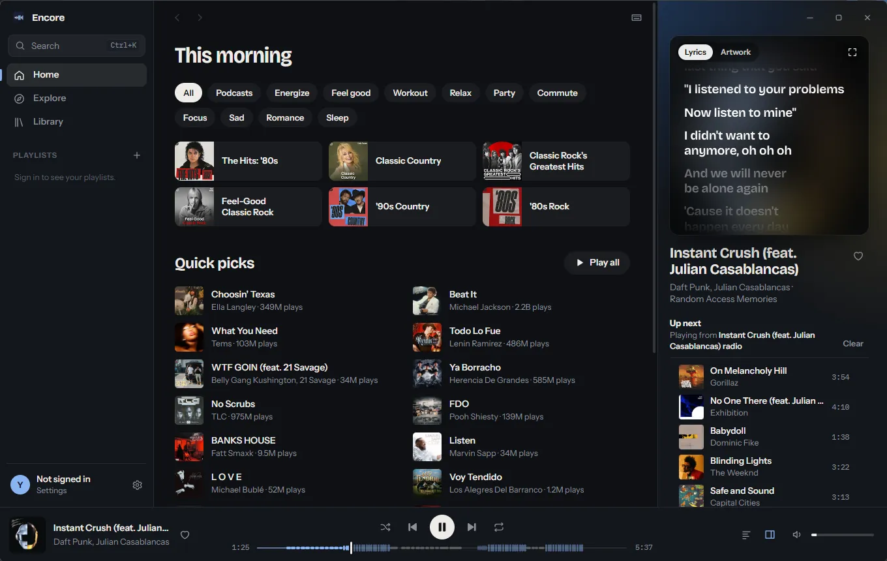
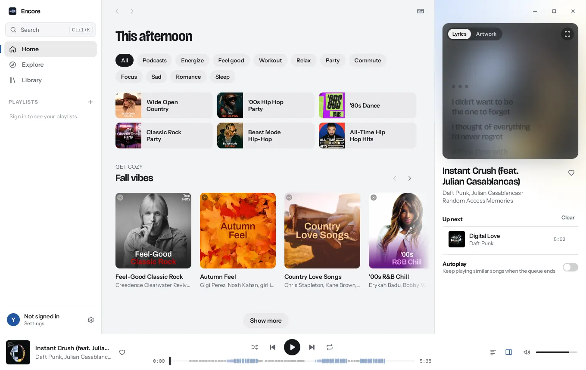

  

  A desktop app for YouTube Music, built with Rust and Tauri. 
  Synced lyrics, a real queue and native playback, in about 20 MB.

  <a href="https://github.com/Nayhap/encore/releases/latest">Download</a> ·
  <a href="docs/development.md">Build from source</a> ·
  <a href="docs/architecture.md">How it works</a>

---

> [!NOTE]
> Encore is unofficial and not affiliated with YouTube or Google. It talks to
> YouTube Music's private web API, which can change without notice. When it
> does, parts of the app may stop working until Encore is updated.

## Features

- **Synced lyrics** from YouTube Music and LRCLIB, in the side panel or full
  screen (<kbd>F</kbd>).
- **A seek bar drawn from the lyrics.** Each sung line is a segment, repeated
  lines stand taller, so you can see the chorus coming and jump to it.
- **Lyrics and the queue side by side** while you browse. Drag to reorder.
- **Search and commands in one box** (<kbd>⌘K</kbd>, or <kbd>Ctrl+K</kbd> on
  Windows and Linux). Shift+Enter plays next.
- **Your library**: playlists, liked songs, albums, artists, subscriptions.
  Brand channels are supported.
- **Playlists you can manage**: create, rename, describe, make private,
  unlisted or public, reorder by dragging, and delete. "Add to playlist"
  warns about duplicates and can start a new playlist.
- **Your history**: plays count in your YouTube Music history and
  recommendations, as in the official app (you can turn this off), and a
  History page shows what you played, by day.
- **Song or video**: switch between a song and its music video (audio
  only) from the now playing panel or any track's menu.
- **Downloads for offline listening**, kept inside Encore: download songs,
  or a playlist, album or your liked songs and it stays up to date. With no
  connection, downloaded songs play and the rest of the queue waits.
- **Native playback** in Rust, with seek, a disk cache and the next song
  loaded ahead of time.
- **Shuffle, repeat and autoplay** that work the way you expect.
- **Media keys and the system's media controls**: Now Playing on macOS, the
  media flyout on Windows, MPRIS on Linux.
- **Runs on macOS, Windows and Linux.**
- **Colours that follow the cover** of the song that's playing, in light or
  dark.

  
  

## Install

  
  

Download the latest build from
[Releases](https://github.com/Nayhap/encore/releases/latest), or
[build it yourself](docs/development.md).

- **macOS**: the `.dmg`, for Apple silicon and Intel. Open it and drag Encore
  to Applications. Builds are not code-signed yet, so the first time you open
  Encore, macOS says “Encore” Not Opened: choose **Done**, then go to
  **System Settings → Privacy & Security** and choose **Open Anyway**. Once you sign in, macOS asks for access to your saved
  session in the Keychain; choose **Always Allow**.
- **Windows 10 and 11**: the `-setup.exe` installer, which installs for your
  user and needs no admin rights. The `.msi` installs for all users and
  needs an administrator. Builds are not code-signed
  yet: SmartScreen warns on first run (choose **More info**, then **Run
  anyway**), and if Smart App Control is on, Windows blocks them.
- **Linux**: the `.deb` for Debian 12 and Ubuntu 22.04 or newer, or the
  `.AppImage` for other distributions with glibc 2.35 or newer. The AppImage
  uses the system's OpenGL and sound libraries, which desktops have; on a
  minimal system install them first (`libegl1 libgl1 libgles2 libgbm1
  libasound2` on Debian and Ubuntu, `libglvnd-gles alsa-lib` on Fedora). To
  stay signed in you need GNOME Keyring or KWallet.

On first launch Encore offers to set up playback. With your OK it downloads
the free components it plays music with, [yt-dlp](https://github.com/yt-dlp/yt-dlp)
and the Python and [Deno](https://deno.com) it runs on, into its own folder:
65 to 80 MB to download and 120 to 160 MB on disk, depending on the system. You can keep browsing while they
install, and nothing else on your computer changes. Encore keeps them up to
date when it updates. **Settings → Playback** shows them and can remove them
to free the space.

Uninstalling keeps Encore's caches, settings, player components (a few
hundred MB at most) and downloads unless you tick **Delete the application data** in the
Windows uninstaller. [Where Encore keeps things](docs/development.md#where-encore-keeps-things)
lists the folders to delete by hand on macOS and Linux, and the saved session
in the system's credential store.

## Signing in

Encore works without an account. To see your library, open **Settings**, then
either:

- **Sign in**: opens a private Google sign-in window inside Encore. Works on
  every system.
- **Import from browser**: copies the YouTube session from a browser you are
  signed in to.
  - macOS: Edge, Chrome, Brave, Firefox or Safari. For the Chromium browsers,
    macOS asks once for access to the browser's "Safe Storage" key; choose
    **Always Allow**.
  - Linux: Edge, Chrome, Brave, Chromium or Firefox. The Chromium browsers'
    key comes from GNOME Keyring or KWallet, which may ask you to unlock it.
  - Windows: Firefox. Current Edge and Chrome protect their cookies with
    app-bound encryption and lock them while running, so other apps can't read
    them. Use **Sign in** for those.

Then pick the channel to use. Your session is stored in the system's
credential store and nowhere else: the macOS Keychain, the Secret Service on
Linux, or Windows Credential Manager (which holds the key to a sealed session
file, since a session is larger than it allows). Encore has no servers and sends no
analytics.

## Keyboard

| Key | Action |
|---|---|
| <kbd>Space</kbd> | Play or pause |
| <kbd>←</kbd> <kbd>→</kbd> | Seek 5 s (with <kbd>⇧</kbd>, 15 s) |
| <kbd>⌘←</kbd> <kbd>⌘→</kbd> | Previous or next song |
| <kbd>[</kbd> <kbd>]</kbd> | Previous or next lyric line |
| <kbd>S</kbd> / <kbd>R</kbd> / <kbd>L</kbd> | Shuffle / repeat / like |
| <kbd>F</kbd> | Full-screen lyrics |
| <kbd>D</kbd> | Download the song that's playing |
| <kbd>⌘K</kbd> | Search and commands |
| <kbd>⌘\\</kbd> | Show or hide the side panel |
| <kbd>?</kbd> | All shortcuts |

On Windows and Linux, use <kbd>Ctrl</kbd> where this table says <kbd>⌘</kbd>.

## Contributing

Bug reports and pull requests are welcome. See
[CONTRIBUTING.md](CONTRIBUTING.md) to get set up.

## Acknowledgements

Encore learned a lot from [Meiro](https://github.com/elianiva/meiro),
[Kopuz](https://github.com/Kopuz-org/kopuz) and
[Better Lyrics](https://github.com/better-lyrics/better-lyrics). Streams come
through [yt-dlp](https://github.com/yt-dlp/yt-dlp), and synced lyrics through
[LRCLIB](https://lrclib.net).

## License

[MIT](LICENSE)
