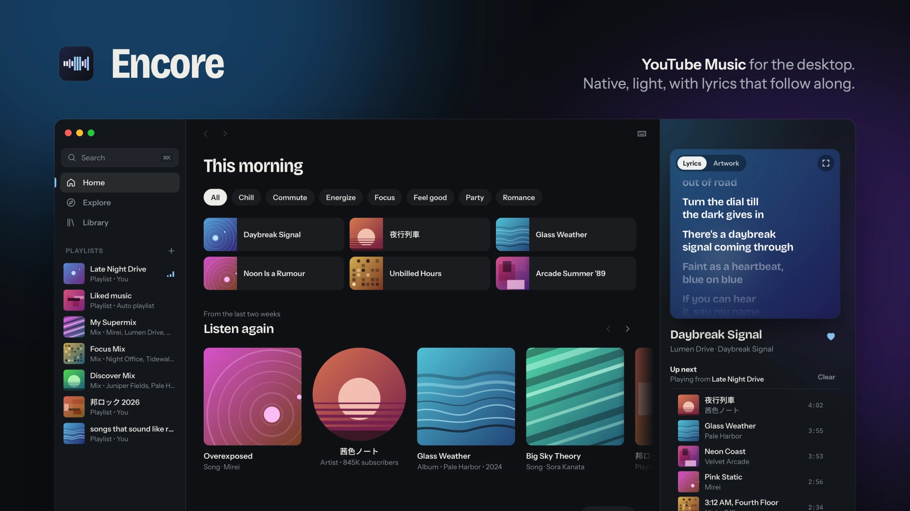
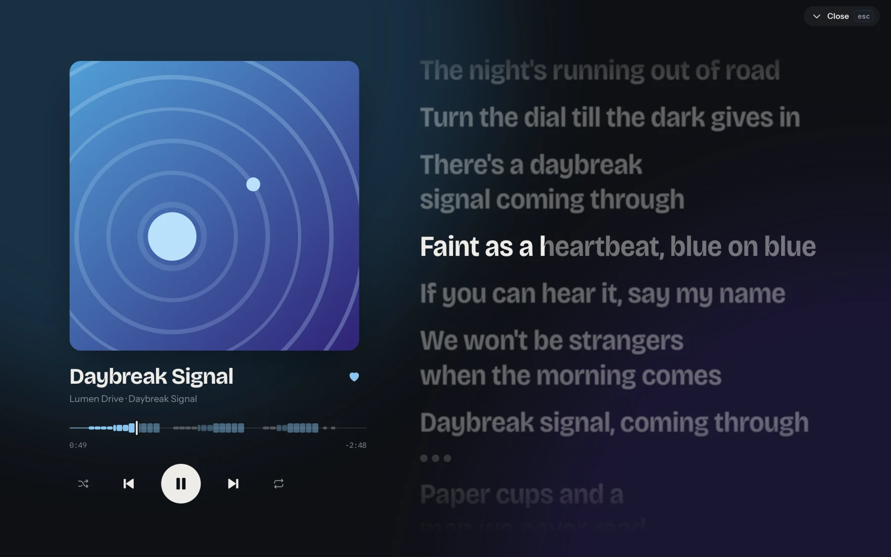
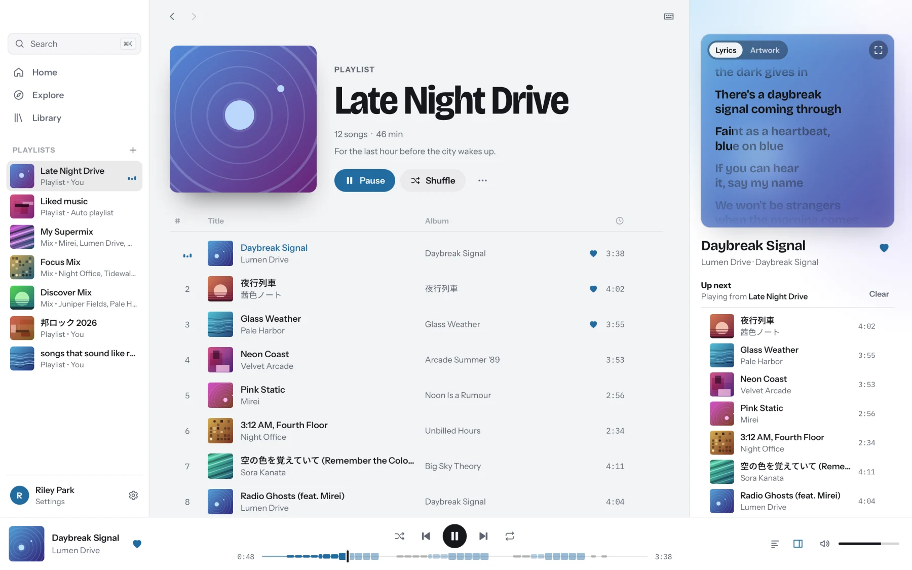
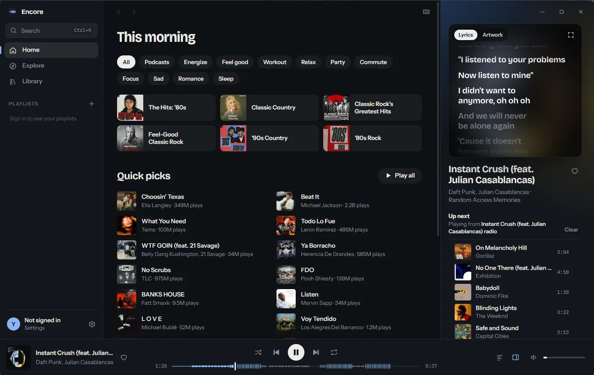
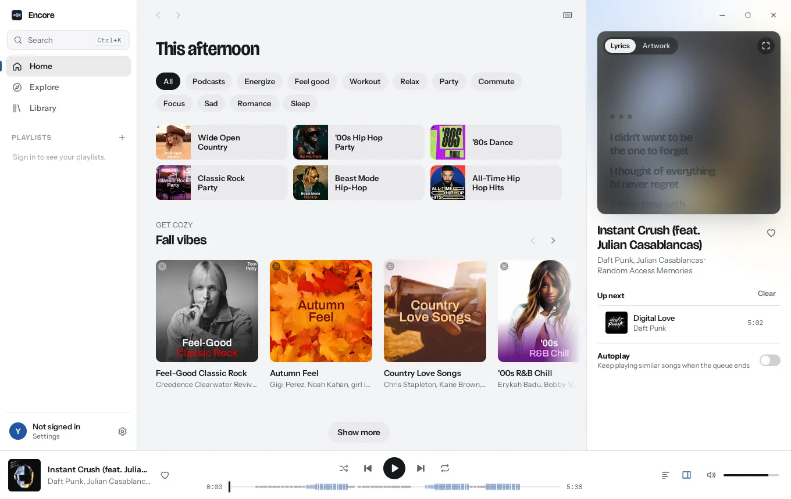

  

  A desktop app for YouTube Music, built with Rust and Tauri. 
  Synced lyrics, a real queue and native playback, in about 20 MB.

  <a href="https://github.com/Nayhap/encore/releases/latest">Download</a> ·
  <a href="docs/development.md">Build from source</a> ·
  <a href="docs/architecture.md">How it works</a>

---

> [!NOTE]
> Encore is unofficial and not affiliated with YouTube or Google. It talks to
> YouTube Music's private web API, which can change without notice. When it
> does, parts of the app may stop working until Encore is updated.

## Features

- **Synced lyrics** from YouTube Music and LRCLIB, in the side panel or full
  screen (<kbd>F</kbd>).
- **A seek bar drawn from the lyrics.** Each sung line is a segment, repeated
  lines stand taller, so you can see the chorus coming and jump to it.
- **Lyrics and the queue side by side** while you browse. Drag to reorder.
- **Search and commands in one box** (<kbd>⌘K</kbd>, or <kbd>Ctrl+K</kbd> on
  Windows and Linux). Shift+Enter plays next; start with `>` for commands,
  `#` for your playlists and folders, `@` for artists, or type `2:15` to jump
  there.
- **Loop part of a song** (<kbd>A</kbd>) and a **sleep timer** that fades out.
- **Bookmarks** for pages, songs and moments in a song (<kbd>B</kbd>).
- **Folders** for your playlists and albums, with your own covers, and a
  small file to share one.
- **Library tools** on every list: find (<kbd>⌘F</kbd>), sort by title,
  year, your plays or Last.fm plays, select many to add, remove, like or
  download, and find duplicates. Artists get their full discography.
- **Your library**: playlists, liked songs, albums, artists, subscriptions.
  Brand channels are supported.
- **Playlists you can manage**: create, rename, describe, make private,
  unlisted or public, reorder by dragging, and delete. "Add to playlist"
  warns about duplicates and can start a new playlist.
- **Your history**: plays count in your YouTube Music history and
  recommendations, as in the official app (you can turn this off), and a
  History page shows what you played, by day, and your listening stats for
  any month or year, kept on your computer.
- **Don't play this again** for songs and artists, **Hide podcasts**, and a
  **private session** that keeps an hour of listening out of your history.
- **Queue tools**: the time left, save a queue and come back to it, or save
  it as a playlist. Shuffle plays every song once before repeating, across
  sessions; Autoplay off means only what you choose plays.
- **Last.fm scrobbling** with your own API key, and **Discord** presence.
- **Song details**: tempo and key estimated from the audio, plays, and the
  file Encore has; artist pages without a description show Wikipedia's.
- **Song or video**: switch between a song and its music video (audio
  only) from the now playing panel or any track's menu.
- **Downloads for offline listening**, kept inside Encore: download songs,
  or a playlist, album or your liked songs and it stays up to date. Offline,
  Encore plays the downloaded songs and skips the others in the queue.
- **Native playback** in Rust, with seek, a disk cache and the next song
  loaded ahead of time.
- **Shuffle, repeat and autoplay** that work the way you expect.
- **Media keys and the system's media controls**: Now Playing on macOS, the
  media flyout on Windows, MPRIS on Linux.
- **Runs on macOS, Windows and Linux.**
- **Colours that follow the cover** of the song that's playing, in light or
  dark, with a soft wash of the cover behind the now playing panel and lyrics.

  
  

## Install

  
  

Download the latest build from
[Releases](https://github.com/Nayhap/encore/releases/latest), or
[build it yourself](docs/development.md).

- **macOS**: the `.dmg`, for Apple silicon and Intel. Open it and drag Encore
  to Applications. Builds are not code-signed yet, so the first time you open
  Encore, macOS says “Encore” Not Opened: choose **Done**, then go to
  **System Settings → Privacy & Security** and choose **Open Anyway**. Once you sign in, macOS asks for access to your saved
  session in the Keychain; choose **Always Allow**.
- **Windows 10 and 11**: the `-setup.exe` installer, which installs for your
  user and needs no admin rights. The `.msi` installs for all users and
  needs an administrator. Builds are not code-signed
  yet: SmartScreen warns on first run (choose **More info**, then **Run
  anyway**), and if Smart App Control is on, Windows blocks them.
- **Linux**: the `.deb` for Debian 12 and Ubuntu 22.04 or newer, the `.rpm`
  for Fedora 40 or newer, or the `.AppImage` for other distributions with
  glibc 2.35 or newer. Install the `.rpm` with
  `sudo dnf install ./Encore-<version>-1.x86_64.rpm`, which also installs
  what it needs. The `.deb` and `.rpm` draw with your system's own WebKit,
  made for your graphics drivers, so prefer them where they fit. The AppImage
  uses the system's OpenGL and sound libraries, which desktops have; on a
  minimal system install them first (`libegl1 libgl1 libgles2 libgbm1
  libasound2` on Debian and Ubuntu, `libglvnd-gles alsa-lib` on Fedora). To
  stay signed in you need GNOME Keyring or KWallet.

There is nothing else to install: Encore finds a song's audio itself, with
an extractor that follows [yt-dlp](https://github.com/yt-dlp/yt-dlp)'s and
yt-dlp's challenge solver built in. Updating from 0.5 removes the Python,
Deno and yt-dlp it downloaded then, which frees 120 to 160 MB.

### Keeping up to date

Encore updates itself from this project's releases. A few times a day it
asks GitHub whether a new version is out, downloads it in the background
and installs it the next time you quit Encore, or straight away when you
choose **Restart to update**. It never restarts by itself. To decide for
yourself, turn off **Settings → Updates → Install updates automatically**:
Encore then only tells you when a new version is out. On macOS, each update
asks once again for access to your saved session in the Keychain; choose
**Always Allow**. Installs from the `.deb` or `.rpm` don't update
themselves: Encore says when a new version is out and links to it.

Uninstalling keeps Encore's caches and settings (a few hundred MB at
most), and your downloads, unless you tick **Delete the
application data** in the Windows uninstaller. [Where Encore keeps things](docs/development.md#where-encore-keeps-things)
lists the folders to delete by hand on macOS and Linux, and the saved session
in the system's credential store.

## Signing in

Encore works without an account. To see your library, open **Settings**, then
either:

- **Sign in**: opens a private Google sign-in window inside Encore. Works on
  every system.
- **Import from browser**: copies the YouTube session from a browser you are
  signed in to.
  - macOS: Edge, Chrome, Brave, Firefox or Safari. For the Chromium browsers,
    macOS asks once for access to the browser's "Safe Storage" key; choose
    **Always Allow**.
  - Linux: Edge, Chrome, Brave, Chromium or Firefox. The Chromium browsers'
    key comes from GNOME Keyring or KWallet, which may ask you to unlock it.
  - Windows: Firefox. Current Edge and Chrome protect their cookies with
    app-bound encryption and lock them while running, so other apps can't read
    them. Use **Sign in** for those.

Then pick the channel to use. Encore keeps the session alive the way a
browser does: a session from **Sign in** is refreshed every few minutes,
and an imported one follows the browser it came from: when that browser
refreshes the session, Encore reads it again. You only need to sign in or
import again after signing out of Google in that browser.

Your session is stored in the system's
credential store and nowhere else: the macOS Keychain, the Secret Service on
Linux, or Windows Credential Manager (which holds the key to a sealed session
file, since a session is larger than it allows). Encore has no servers and sends no
analytics.

## Keyboard

| Key | Action |
|---|---|
| <kbd>Space</kbd> | Play or pause |
| <kbd>←</kbd> <kbd>→</kbd> | Seek 5 s (with <kbd>⇧</kbd>, 15 s) |
| <kbd>⌘←</kbd> <kbd>⌘→</kbd> | Previous or next song |
| <kbd>[</kbd> <kbd>]</kbd> | Previous or next lyric line |
| <kbd>S</kbd> / <kbd>R</kbd> / <kbd>L</kbd> | Shuffle / repeat / like |
| <kbd>F</kbd> | Full-screen lyrics |
| <kbd>D</kbd> | Download the song that's playing |
| <kbd>A</kbd> | Loop: set its start, then its end; again to clear |
| <kbd>B</kbd> | Bookmark this moment of the song |
| <kbd>⌘F</kbd> | Find in a playlist, album or Library list |
| <kbd>⌘K</kbd> | Search and commands |
| <kbd>⌘\\</kbd> | Show or hide the side panel |
| <kbd>?</kbd> | All shortcuts |

On Windows and Linux, use <kbd>Ctrl</kbd> where this table says <kbd>⌘</kbd>.

## Contributing

Bug reports and pull requests are welcome. See
[CONTRIBUTING.md](CONTRIBUTING.md) to get set up.

## Acknowledgements

Encore learned a lot from [Meiro](https://github.com/elianiva/meiro),
[Kopuz](https://github.com/Kopuz-org/kopuz) and
[Better Lyrics](https://github.com/better-lyrics/better-lyrics). Streams are
found the way [yt-dlp](https://github.com/yt-dlp/yt-dlp) finds them, with
[yt-dlp-ejs](https://github.com/yt-dlp/ejs) on
[QuickJS-ng](https://github.com/quickjs-ng/quickjs) for YouTube's challenges,
and synced lyrics come through [LRCLIB](https://lrclib.net).

## License

[MIT](LICENSE)
