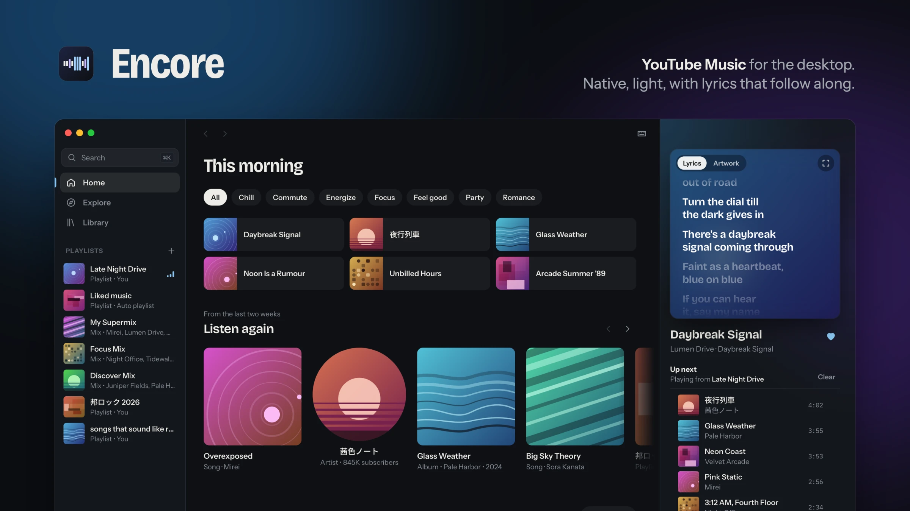
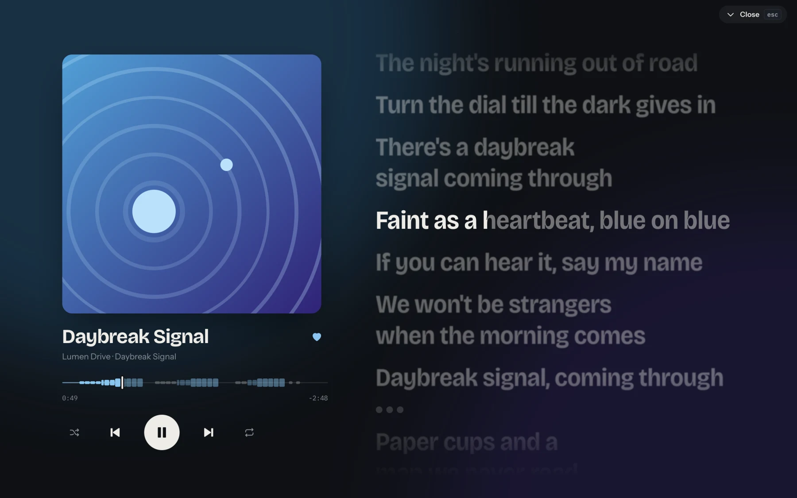
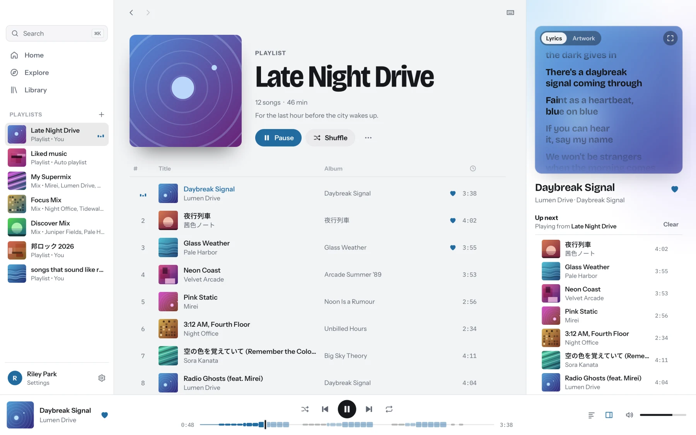

  

  A desktop app for YouTube Music, built with Rust and Tauri. 
  Synced lyrics, a real queue and native playback, in about 20 MB.

  <a href="https://github.com/Nayhap/encore/releases/latest">Download</a> ·
  <a href="docs/development.md">Build from source</a> ·
  <a href="docs/architecture.md">How it works</a>

---

> [!NOTE]
> Encore is unofficial and not affiliated with YouTube or Google. It talks to
> YouTube Music's private web API, which can change without notice. When it
> does, parts of the app may stop working until Encore is updated.

## Features

- **Synced lyrics** from YouTube Music and LRCLIB, in the side panel or full
  screen (<kbd>F</kbd>).
- **A seek bar drawn from the lyrics.** Each sung line is a segment, repeated
  lines stand taller, so you can see the chorus coming and jump to it.
- **Lyrics and the queue side by side** while you browse. Drag to reorder.
- **Search and commands in one box** (<kbd>⌘K</kbd>). Shift+Enter plays next.
- **Your library**: playlists, liked songs, albums, artists, subscriptions.
  Brand channels are supported.
- **Native playback** in Rust, with seek, a disk cache and the next song
  loaded ahead of time.
- **Shuffle, repeat and autoplay** that work the way you expect.
- **Media keys and macOS Now Playing.**
- **Colours that follow the cover** of the song that's playing, in light or
  dark.

  
  

## Install

Encore runs on macOS today. Windows and Linux are planned.

Download the latest build from
[Releases](https://github.com/Nayhap/encore/releases/latest), or
[build it yourself](docs/development.md).

Playback needs **Python 3.10 or newer** and **Node.js, Deno or Bun** on your
Mac. Encore sets up its own copy of [yt-dlp](https://github.com/yt-dlp/yt-dlp)
on first launch and uses it to get audio streams.

## Signing in

Encore works without an account. To see your library, open **Settings**, then
either:

- **Import from browser**: copies the YouTube session from Edge, Chrome,
  Brave, Firefox or Safari. For Chromium browsers, macOS asks once for access
  to the browser's "Safe Storage" key; choose **Always Allow**.
- **Sign in**: opens a private Google sign-in window inside Encore.

Then pick the channel to use. Your session is stored in the macOS Keychain
and nowhere else. Encore has no servers and sends no analytics.

## Keyboard

| Key | Action |
|---|---|
| <kbd>Space</kbd> | Play or pause |
| <kbd>←</kbd> <kbd>→</kbd> | Seek 5 s (with <kbd>⇧</kbd>, 15 s) |
| <kbd>⌘←</kbd> <kbd>⌘→</kbd> | Previous or next song |
| <kbd>[</kbd> <kbd>]</kbd> | Previous or next lyric line |
| <kbd>S</kbd> / <kbd>R</kbd> / <kbd>L</kbd> | Shuffle / repeat / like |
| <kbd>F</kbd> | Full-screen lyrics |
| <kbd>⌘K</kbd> | Search and commands |
| <kbd>⌘\\</kbd> | Show or hide the side panel |
| <kbd>?</kbd> | All shortcuts |

## Contributing

Bug reports and pull requests are welcome. See
[CONTRIBUTING.md](CONTRIBUTING.md) to get set up.

## Acknowledgements

Encore learned a lot from [Meiro](https://github.com/elianiva/meiro),
[Kopuz](https://github.com/Kopuz-org/kopuz) and
[Better Lyrics](https://github.com/better-lyrics/better-lyrics). Streams come
through [yt-dlp](https://github.com/yt-dlp/yt-dlp), and synced lyrics through
[LRCLIB](https://lrclib.net).

## License

[MIT](LICENSE)
